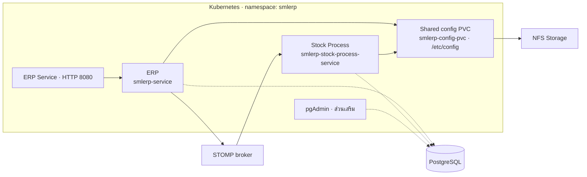

# AIS K8s Pre POC Lab Config

ดู [คู่มือ Deploy และลำดับการติดตั้ง](INSTALL.md) สำหรับ requirements และขั้นตอน deploy YAML จนถึงการทดสอบบริการ

## ภาพรวมระบบ

## Pre-requisites

- Kubernetes Cluster
- NFS Storage

## Quick Start

รันจาก root ของ repository ตามลำดับนี้ โดยดูคำสั่งและรายละเอียดใน [INSTALL.md](INSTALL.md)

1. **เตรียมระบบพื้นฐาน** — Kubernetes พร้อมใช้งาน, NFS provisioner และ StorageClass `nfs-client` พร้อม รวมถึง PostgreSQL, broker ที่รองรับ STOMP และไฟล์ config ของแอป
2. **สร้าง namespace `smlerp`** — ก่อนสร้าง resource ของแอปทั้งหมด
3. **สร้าง PVC สำหรับ config** — deploy `smlerp-service/smlerp-service-config-pvc.yaml` และรอ PVC เป็น `Bound`
4. **นำไฟล์ config ลง PVC** — ใช้ Pod ชั่วคราวตามคู่มือ คัดลอกไฟล์ให้ครบก่อนเริ่ม ERP และ Stock Process
5. **สร้าง Secrets ของทั้งสองบริการ** — ทำสำเนาและปรับค่าจาก `smlerp-service/smlerp-service-secret.yaml` และ `stockprocess-service/smlerp-stock-process-service-secret.yaml` ให้ตรงกับระบบจริง แล้ว deploy สำเนาที่แก้แล้ว
6. **Deploy ERP** — deploy `smlerp-service/smlerp-service-service-clusterip.yaml` ก่อน แล้วตามด้วย `smlerp-service/smlerp-service-deployment.yaml` และรอ rollout สำเร็จ
7. **Deploy Stock Process** — deploy `stockprocess-service/smlerp-stock-process-service-deployment.yaml` และรอ rollout สำเร็จ
8. **ทดสอบบริการ** — ใช้ port-forward ตรวจ health ของทั้งสองบริการ แล้วทดสอบการเชื่อมต่อฐานข้อมูลและการส่ง/รับงานผ่าน broker

เมื่อตัวแอปพร้อมแล้ว จึง deploy ส่วนเสริมตามต้องการ:

- **pgAdmin** — deploy `pgadmin/pgadmin-service.yaml` แล้วตามด้วย `pgadmin/pgadmin-deployment.yaml`
- **เปิด ERP ให้เข้าถึงจากภายนอก** — เลือก LoadBalancer หรือ Ingress ตามคู่มือ โดยตรวจและปรับ Ingress ก่อน deploy

ไฟล์ใน `postgresql/` และ `rabbitmq/` เป็น Docker Compose ให้เตรียมแยกต่างหาก ไม่ใช้ `kubectl apply`
